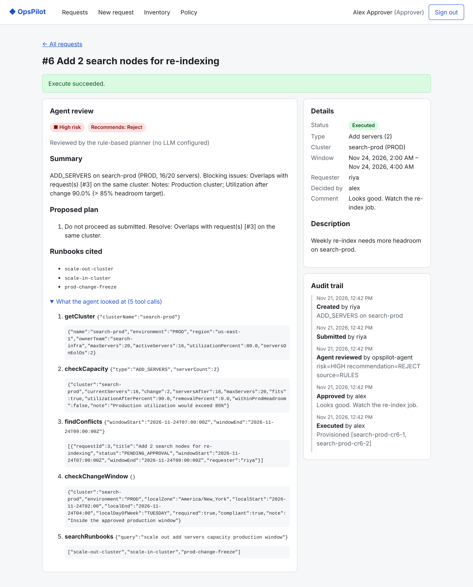
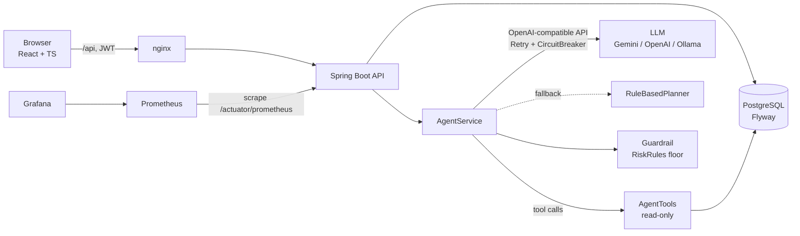
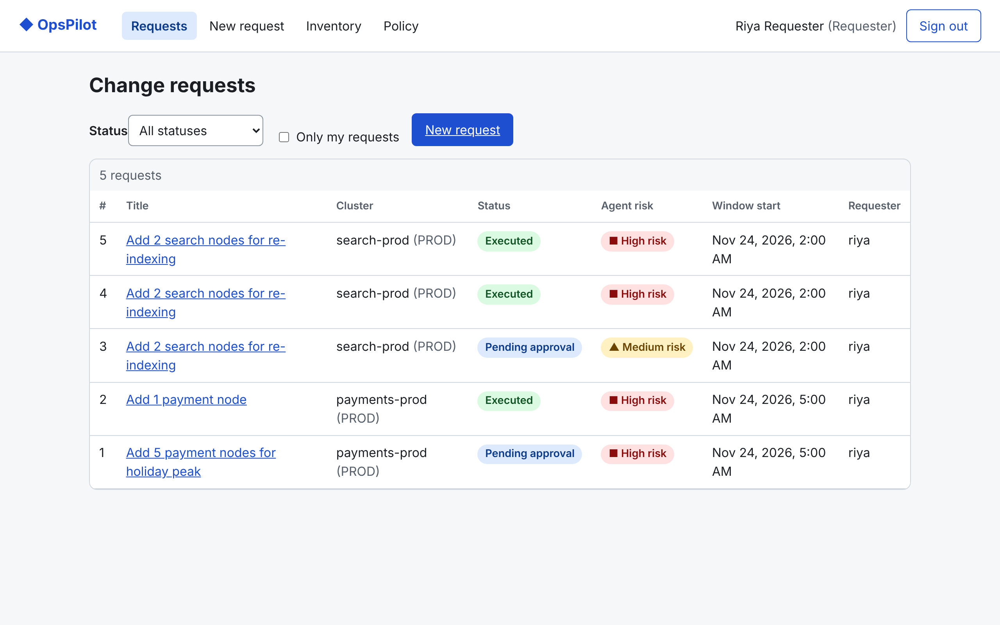
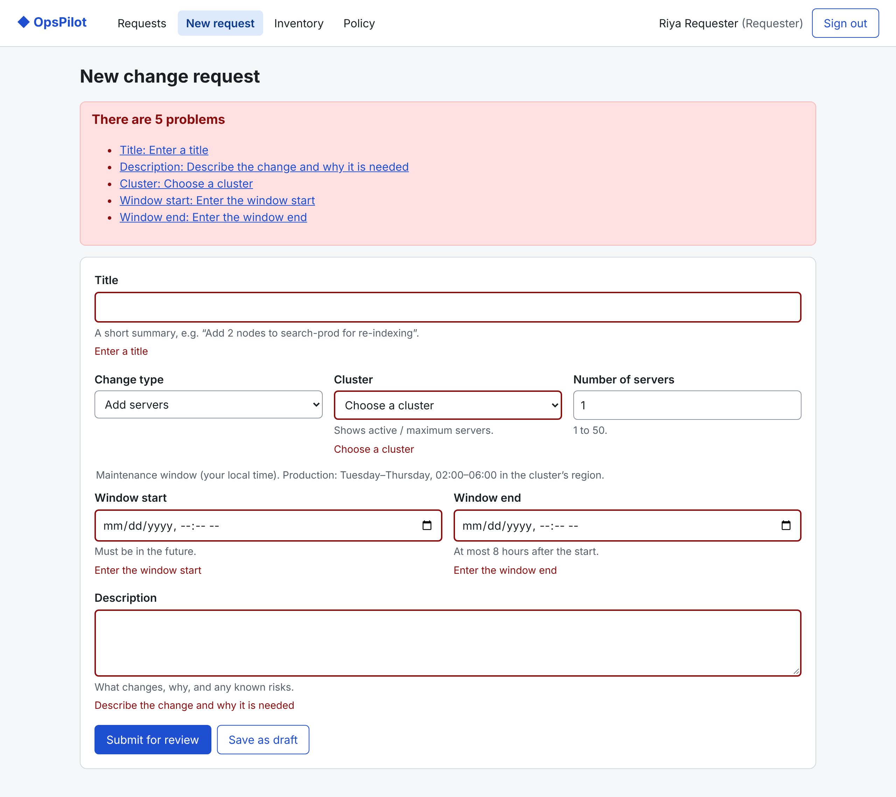
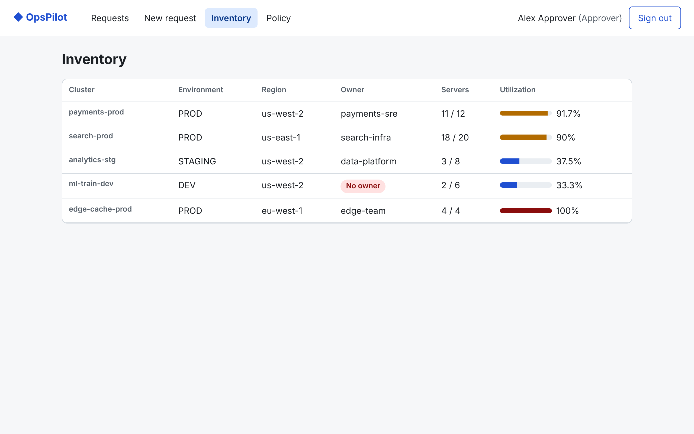
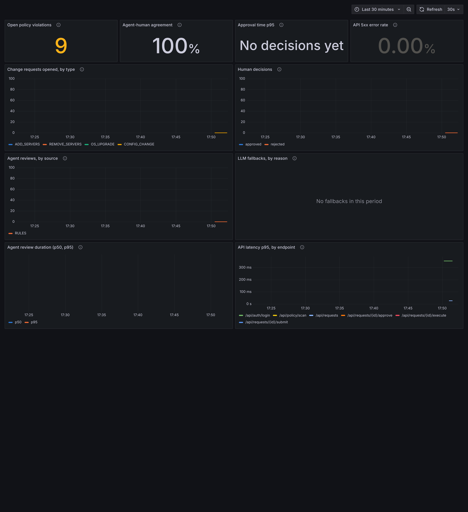

# OpsPilot

**AI-assisted infrastructure change requests with mandatory human approval.**

Engineers file change requests ("add 2 servers to `search-prod` Tuesday 02:00"). An LLM agent investigates each one with
read-only tools (capacity, conflicts, change windows, runbook search), drafts a risk assessment and rollout plan, and
cites the runbooks it used. **Nothing runs until a human approver signs off**, and every step lands in an audit trail.

Java 21 · Spring Boot 3.5 · PostgreSQL 16 · React 18 + TypeScript · LLM tool calling · Resilience4j · Prometheus + Grafana · Docker · GitHub Actions



---

## Highlights

| Area | What's implemented |
|---|---|
| **Agentic workflow** | LLM tool-calling loop over 5 read-only tools; runbook retrieval (PostgreSQL full-text search) with citations; unretrieved citations are stripped (hallucination check); full tool trace shown to approvers |
| **Human-in-the-loop** | State machine `DRAFT → AGENT_REVIEW → PENDING_APPROVAL → APPROVED/REJECTED → EXECUTED`; approvers can't approve their own requests (separation of duties); append-only audit log |
| **Safety** | Deterministic guardrail: the LLM can raise risk but never lower it below rule-based checks; prompt-injection defenses (delimited untrusted input, read-only tools, guardrail, human approval) |
| **Graceful failure** | Retry with backoff + circuit breaker around the LLM; automatic fallback to a rule-based planner; works fully with no LLM configured |
| **Security** | JWT (HS256) auth, BCrypt passwords, role-based access (least privilege), brute-force lockout, timing-safe login, Bean Validation on every input, RFC 7807 errors, CSP and frame-deny headers |
| **Evaluation** | 30-case labelled test set incl. prompt-injection cases; scores raw LLM vs guardrailed vs rules ([`eval/`](eval/)) |
| **Observability** | Business + technical metrics (Micrometer → Prometheus), provisioned Grafana dashboard, request-id correlated logs, JSON logs in prod, health probes |
| **Policy automation** | Nightly, idempotent compliance scan (owner, tags, end-of-life OS) that auto-resolves fixed findings |
| **Accessibility** | WCAG 2.1 AA: axe-core reports 0 violations on all pages (incl. color contrast in a real browser); error summary pattern, focus management, skip link |
| **Quality** | 58 backend tests (unit + Testcontainers integration), 10 frontend tests, ~90% backend line coverage, CI on every push |

## Architecture



Agent review flow on submit: commit `AGENT_REVIEW` → run agent **outside** any DB transaction (slow network call) →
commit the review and move to `PENDING_APPROVAL`.

## Live demo

[](https://render.com/deploy?repo=https://github.com/nagajaideep/opspilot)

Hosted on Render's free tier from [`render.yaml`](render.yaml): the API sleeps after 15 minutes idle, so the first
request can take about a minute. Prometheus and Grafana run in the local Docker setup only.

## Quick start

Requires Docker.

```bash
docker compose up --build
```

| URL | What |
|---|---|
| http://localhost:3000 | The app. Users `riya`, `sam` (requester), `alex` (approver), `ada` (admin); password `opspilot-demo` |
| http://localhost:8080/swagger-ui.html | API docs (OpenAPI) |
| http://localhost:3001 | Grafana (`admin` / `admin`), dashboard "OpsPilot" |
| http://localhost:9090 | Prometheus |

**Try it:** sign in as `riya`, create *Add 3 servers* on `payments-prod` (10/12 used) → the agent flags HIGH risk and
suggests splitting the change. Sign out, sign in as `alex`, and decide.

### Turn on the LLM

Without a key, reviews come from the rule-based planner (labelled "RULES" in the UI). Any OpenAI-compatible endpoint works:

```bash
cp .env.example .env      # then edit .env
# Gemini (free tier):  LLM_BASE_URL=https://generativelanguage.googleapis.com/v1beta/openai  LLM_MODEL=gemini-2.5-flash
# OpenAI:              LLM_BASE_URL=https://api.openai.com/v1                                  LLM_MODEL=gpt-4o-mini
# Ollama (local):      LLM_BASE_URL=http://host.docker.internal:11434/v1                       LLM_MODEL=llama3.1
LLM_ENABLED=true LLM_API_KEY=... docker compose up --build
```

## Local development

```bash
docker run -d --name opspilot-db -e POSTGRES_DB=opspilot -e POSTGRES_USER=opspilot -e POSTGRES_PASSWORD=opspilot -p 5432:5432 postgres:16-alpine
cd backend && mvn spring-boot:run          # http://localhost:8080
cd frontend && npm install && npm run dev  # http://localhost:5173 (proxies /api to :8080)
```

## Tests and evaluation

```bash
cd backend && mvn verify        # 58 tests; needs Docker (Testcontainers). Coverage: target/site/jacoco/index.html
cd frontend && npm test         # 10 tests incl. axe-core accessibility checks
cd backend && LLM_ENABLED=true LLM_API_KEY=... mvn test -Peval   # agent eval -> eval/report.md
```

The eval scores three reviewers on [30 labelled cases](eval/cases.json): the **raw LLM** (the honest agent-accuracy
number), the LLM **after the guardrail** (what users see), and the **rule-based baseline** (30/30; a label-consistency check).

## Project structure

```
backend/src/main/java/dev/opspilot/
  agent/      LLM agent loop, tools, runbook search, risk rules, guardrail, fallback planner
  request/    change-request state machine, workflow service, REST API
  auth/       JWT issuing/validation, security config, login lockout
  inventory/  clusters and servers
  policy/     nightly compliance scan
  audit/      append-only audit log
  common/     error handling (RFC 7807), request-id filter, metrics
backend/src/main/resources/db/migration/   Flyway SQL migrations (schema + seed data)
frontend/src/   pages/, components/, api.ts (typed client), auth.tsx
infra/          Prometheus config, Grafana provisioning + dashboard JSON
eval/           labelled agent test set and latest report
docs/           LEARNING.md (concepts + interview prep), DEPLOY.md, screenshots/
```

## Design decisions

- **LLM behind an interface, rules as a floor.** The model adds judgment and readable plans; deterministic checks
  guarantee hard limits (capacity, overlaps, windows). Raising risk is allowed, lowering it is not.
- **Full-text search, not vectors, for retrieval.** Seven short runbooks don't need embeddings; `tsvector` + `ts_rank`
  is exact, explainable and free. Switch to pgvector when the corpus grows or queries get fuzzier.
- **No slow calls inside transactions.** Submitting is split into two short transactions around the LLM call.
- **Server decides the buttons.** The API returns `allowedActions`, so the UI never re-implements permission logic,
  and every action is re-checked server-side.
- **Execution re-checks capacity.** Inventory can change between review and execution; the execute step validates again.

See [docs/LEARNING.md](docs/LEARNING.md) for the reasoning behind each part, and [docs/DEPLOY.md](docs/DEPLOY.md) to deploy.

## Screenshots

| | |
|---|---|
|  |  |
|  |  |
